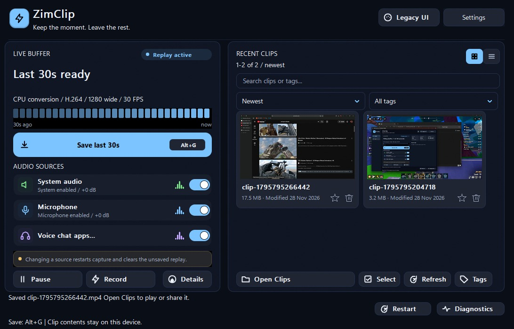
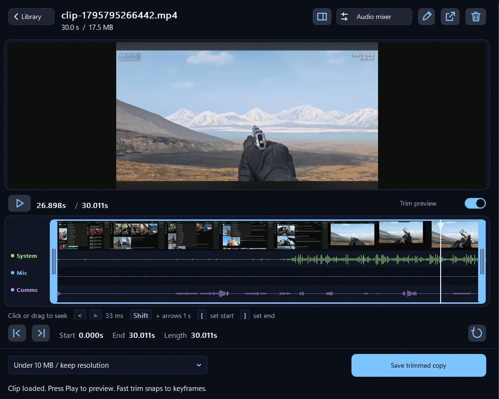
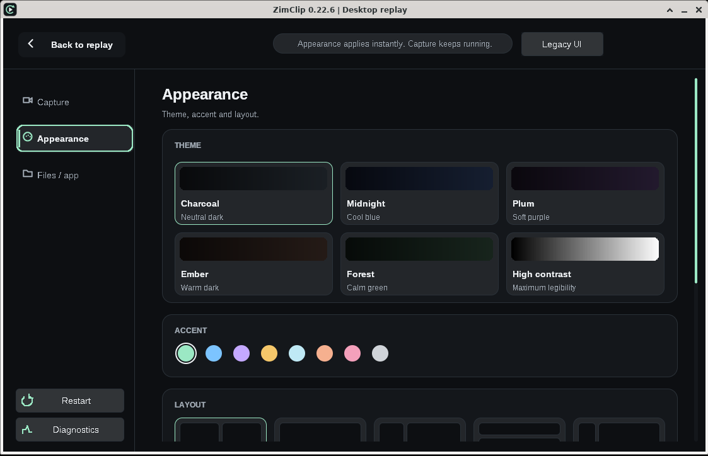
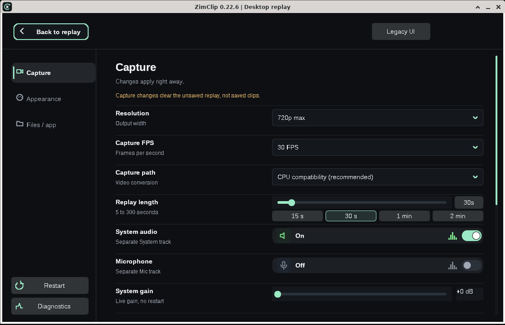

# ZimClip

Have you ever jumped off a 1,600 foot tall building in-game, landed a perfect 360 no-scope, and then realized you never got to share the moment? Worry no more, because ZimClip is here to help. (In-game only. Please do not test gravity in real life.)

ZimClip is a lightweight instant-replay clipper for Windows. It keeps a rolling replay buffer of your screen and audio, and a hotkey (Alt+G) saves that moment as an MP4. A built-in editor trims, scrubs and exports clips. The goal is to stay light while you play.

Status: 0.22.6, Windows x64. Not code-signed, so Windows SmartScreen may warn on first run.

## Screenshots

The main window, with the 30 second replay buffer running and saved clips ready:



The replay workbench, with preview, trim handles and separate audio tracks:



<details>
<summary>Settings (rendered under Wine, so fonts and window chrome may look slightly different on Windows)</summary>





</details>

## Download

Download:

- Installer: https://hadir-reminders.3jk1zs.workers.dev/dl/zimclip-0.22.6-setup.exe
- Portable ZIP: https://hadir-reminders.3jk1zs.workers.dev/dl/zimclip-0.22.6.zip

- `ZimClip-0.22.6-setup.exe`: installs for your Windows account only, no administrator rights needed.
- `ZimClip-0.22.6.zip`: portable. Extract into its own new folder and run `ZimClip.exe`.

Settings and clips are kept next to `ZimClip.exe`, so use a folder you can write to.

## Update check

About 30 seconds after ZimClip starts (including when it starts in the tray with Windows), it makes one small HTTPS request to read the newest version number from `zimclip-latest.json` (address in `src/updater.rs`). The version is compared on your PC and nothing else is sent, though any web host can see your IP address. Nothing is downloaded unless you click "Update now". There is no setting to turn the check off in this version.

## Build

Rust, target `x86_64-pc-windows-gnu`, mingw-w64 (posix threads), static CRT:

```
RUSTFLAGS="-C target-feature=+crt-static" cargo build --release --target x86_64-pc-windows-gnu
```

Host tests: `cargo test --release`. Windows-only modules are only checked by the Windows build. See `BUILDING.txt`.

ZimClip runs three helper programs next to it (`capture-engine.exe`, `media-analysis.exe`, `media-export.exe`). They are separate FFmpeg 9.1 builds (LGPL v2.1 or later, built without GPL or nonfree options). Their source, patch and build configuration are in `Source-and-licenses.zip` in the release download.

## License

ZimClip is released under the [MIT License](LICENSE), Copyright (c) 2026 Zims. The icons and the clip sound were generated for this project by scripts; no third-party assets are used.

Third-party parts keep their own licenses: Rust crates (see `dependency-licenses/`), FFmpeg (LGPL v2.1 or later), OpenH264 (BSD) and AMD AMF headers (MIT). Audio and video formats such as H.264 and AAC can be covered by patents in some countries; these licenses do not grant those rights.

FFmpeg is a trademark of Fabrice Bellard. ZimClip is not affiliated with the FFmpeg project.
